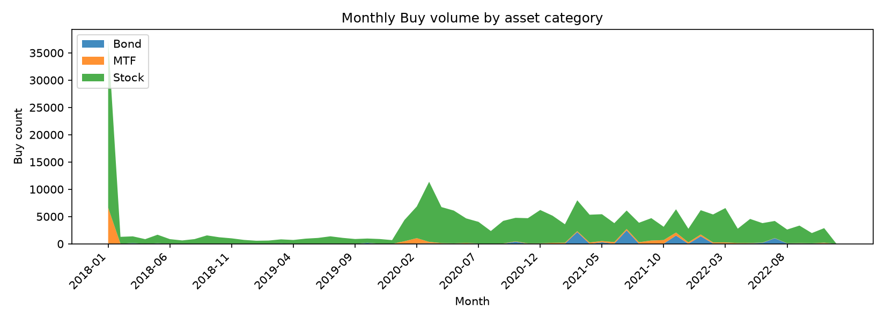
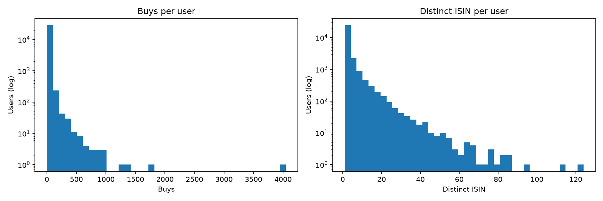

<!-- auto-generated by scripts/eda.py — do not edit manually -->
# FAR-Trans EDA (Session 1)

All numbers below are computed over **Buy transactions only** unless stated otherwise.

## 1. Monthly Buy volume by asset category (2018–2022)

| Month | Bond | MTF | Stock | Total |
|-------|-----:|----:|------:|------:|
| 2018-01 | 88 | 6534 | 30852 | 37474 |
| 2018-02 | 2 | 13 | 1268 | 1283 |
| 2018-03 | 144 | 6 | 1222 | 1372 |
| 2018-04 | 2 | 2 | 851 | 855 |
| 2018-05 | 100 | 10 | 1560 | 1670 |
| 2018-06 | 10 | 2 | 850 | 862 |
| 2018-07 | 5 | 6 | 612 | 623 |
| 2018-08 | 2 | 7 | 861 | 870 |
| 2018-09 | 1 | 6 | 1541 | 1548 |
| 2018-10 | 2 | 7 | 1195 | 1204 |
| 2018-11 | 11 | 3 | 994 | 1008 |
| 2018-12 | 3 | 4 | 713 | 720 |
| 2019-01 | 5 | 3 | 559 | 567 |
| 2019-02 | 1 | 2 | 599 | 602 |
| 2019-03 | 85 | 2 | 735 | 822 |
| 2019-04 | 6 | 15 | 687 | 708 |
| 2019-05 | 0 | 5 | 947 | 952 |
| 2019-06 | 0 | 8 | 1075 | 1083 |
| 2019-07 | 30 | 8 | 1339 | 1377 |
| 2019-08 | 1 | 3 | 1089 | 1093 |
| 2019-09 | 1 | 6 | 875 | 882 |
| 2019-10 | 185 | 11 | 777 | 973 |
| 2019-11 | 8 | 21 | 853 | 882 |
| 2019-12 | 1 | 2 | 680 | 683 |
| 2020-01 | 45 | 432 | 3891 | 4368 |
| 2020-02 | 85 | 959 | 5803 | 6847 |
| 2020-03 | 115 | 251 | 11006 | 11372 |
| 2020-04 | 68 | 71 | 6598 | 6737 |
| 2020-05 | 23 | 72 | 6002 | 6097 |
| 2020-06 | 74 | 91 | 4499 | 4664 |
| 2020-07 | 35 | 40 | 3953 | 4028 |
| 2020-08 | 29 | 31 | 2291 | 2351 |
| 2020-09 | 28 | 48 | 4132 | 4208 |
| 2020-10 | 401 | 66 | 4301 | 4768 |
| 2020-11 | 16 | 75 | 4612 | 4703 |
| 2020-12 | 17 | 81 | 6104 | 6202 |
| 2021-01 | 26 | 153 | 4978 | 5157 |
| 2021-02 | 41 | 161 | 3386 | 3588 |
| 2021-03 | 2157 | 166 | 5657 | 7980 |
| 2021-04 | 15 | 231 | 5092 | 5338 |
| 2021-05 | 279 | 238 | 4912 | 5429 |
| 2021-06 | 37 | 280 | 3475 | 3792 |
| 2021-07 | 2463 | 265 | 3378 | 6106 |
| 2021-08 | 16 | 280 | 3567 | 3863 |
| 2021-09 | 25 | 588 | 4095 | 4708 |
| 2021-10 | 36 | 656 | 2435 | 3127 |
| 2021-11 | 1507 | 564 | 4266 | 6337 |
| 2021-12 | 15 | 266 | 2488 | 2769 |
| 2022-01 | 1389 | 320 | 4459 | 6168 |
| 2022-02 | 69 | 189 | 5128 | 5386 |
| 2022-03 | 64 | 191 | 6303 | 6558 |
| 2022-04 | 40 | 104 | 2635 | 2779 |
| 2022-05 | 99 | 52 | 4414 | 4565 |
| 2022-06 | 185 | 45 | 3566 | 3796 |
| 2022-07 | 1027 | 35 | 3131 | 4193 |
| 2022-08 | 72 | 30 | 2517 | 2619 |
| 2022-09 | 95 | 42 | 3208 | 3345 |
| 2022-10 | 68 | 28 | 1878 | 1974 |
| 2022-11 | 105 | 103 | 2670 | 2878 |
| 2022-12 | 0 | 0 | 0 | 0 |

**Total Buy transactions:** 228913.

## 2. Number of Buy transactions per user

- Users (with ≥1 Buy): **29090**.
- Quantiles (Buys/user): 2 (p50), 4 (p75), 13 (p90), 114 (p99).
- Users by Buy count:
  - 1 Buy: **13906** (47.80%)
  - 2–4 Buys: **8833** (30.36%)
  - 5–9 Buys: **2738** (9.41%)
  - 10+ Buys: **3613** (12.42%)

- Distinct ISINs per user:
  - Quantiles: 1 (p50), 3 (p75), 6 (p90), 24 (p99).
  - 1 ISIN: **14915** (51.27%); 2–4: **9560** (32.86%); 5–9: **2927** (10.06%); 10+: **1688** (5.80%).

## 3. Repeat purchases

A Buy is a *repeat* if the same user already bought the same ISIN earlier.

- Overall repeat share: **139029** of 228913 Buys (60.73%).

| Category | Buys | Repeat share |
|----------|-----:|-------------:|
| Bond | 11459 | 7.47% |
| MTF | 13890 | 11.32% |
| Stock | 203564 | 67.10% |

## 4. Popularity concentration

- Distinct ISINs bought at least once: **320**.
- Top-10 ISINs: **48.23%** of all Buys (110398 of 228913).
- Top-50 ISINs: **82.77%** of all Buys (189464 of 228913).

| Category | Distinct ISIN | Top-10 share | Top-50 share |
|----------|--------------:|-------------:|-------------:|
| Bond | 49 | 89.11% | 100.00% |
| MTF | 60 | 84.98% | 99.93% |
| Stock | 211 | 54.23% | 87.91% |

## 5. Provisional cut scenarios

> **These are NOT the official split.** The official time cut / evaluated users are
> still pending. Cuts below are only exploratory, for a rough feasibility check.
> Test window = [cut, end of data]; "before cut" = `timestamp < cut`.

| Cut | Eval users (≥1 before & ≥1 after) | Future-ISIN already known | Future Buys in pre-cut top-10 | Assets priced before cut | Eval users: 1 / 2–4 / 5+ pre-cut Buys |
|-----|-----------------------------------:|---------------------------:|------------------------------:|--------------------------:|-----------------------------------------:|
| 2022-03-01 | 4211 | 75.44% | 51.03% | 792 | 420 / 880 / 2911 |
| 2022-06-01 | 3178 | 75.19% | 47.33% | 796 | 289 / 566 / 2323 |
| 2022-09-01 | 1728 | 78.62% | 43.86% | 803 | 78 / 149 / 1501 |

## 6. Observations (facts only)

- Buy volume is heavily concentrated: the top-10 ISINs account for ~48% and the
  top-50 for ~83% of all Buys (§4).
- **Stock** is by far the largest category by Buy volume, followed by MTF and Bond
  (§1, §3).
- A majority of Buys are repeat purchases of an ISIN the user already bought (§3).
- 2018-01 is an outlier month in the monthly table (§1).
- Under every provisional cut, the pre-cut popularity top-10 recovers roughly
  44–51% of future Buy volume, and ~75–79% of future Buys are of already-known
  ISINs (§5).
