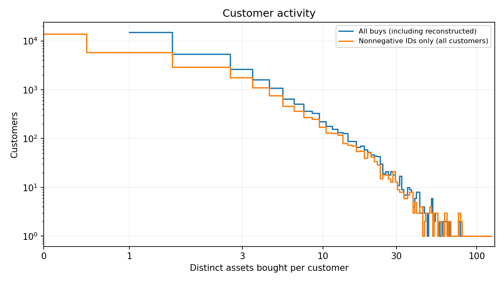
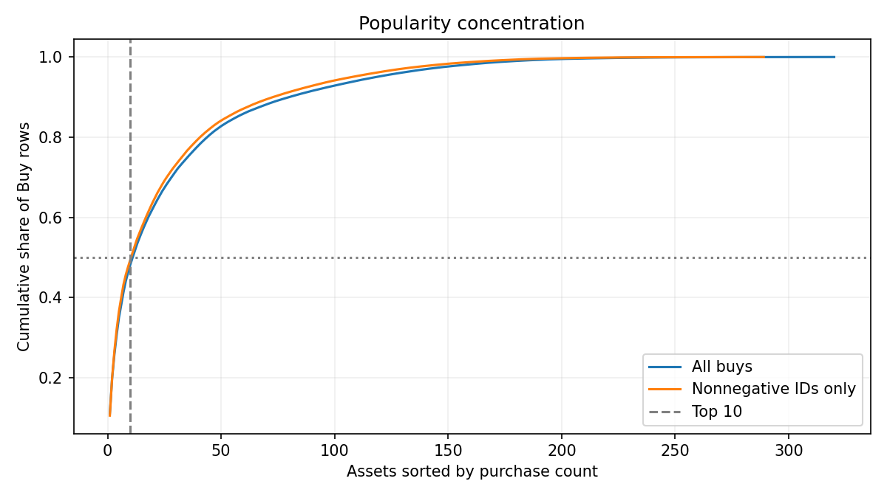
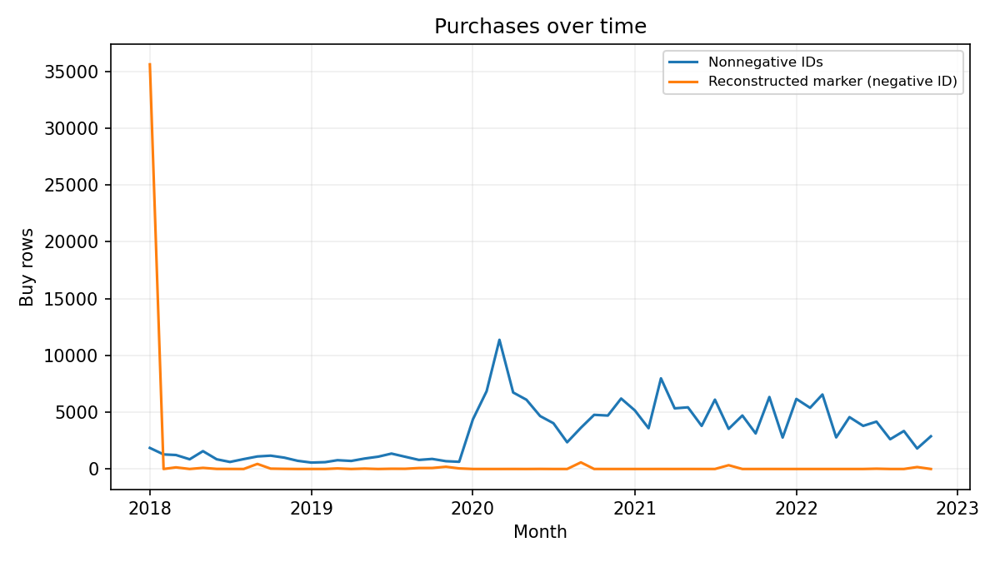

# EDA для дальнейшего выбора RQ

> Сгенерировано `scripts/run_analysis.py`; измеренные числа вычислены из CSV, не вписаны в Markdown вручную. Известные числа статьи отдельно помечены как цитируемые. Идентификаторы клиентов не публикуются.

Архив: `FAR-Trans.zip`, SHA-256: `d0d6cfe027732bab45fdcf9af80eff4fefddc789aedae9bdce0d3d6cfd05cfb6`.

Это измеренные результаты разведки, не готовый выбор трека или доказательство эффекта LLM. Все доли покупок ниже считаются по строкам Buy, если явно не сказано иначе; не смешиваем их со всеми Buy+Sell.

## Основные числа

| Показатель | Количество |
| --- | --- |
| Транзакции | 388048 |
| Клиенты в транзакциях | 29090 |
| Активы в metadata, unique ISIN | 806 |
| Активы с ценами, unique ISIN | 807 |
| Активы с транзакциями, unique ISIN | 320 |
| Покупки всего | 228913 |
| Buy с неотрицательным ID | 190894 |
| Распознаваемые восстановленные Buy (ID < 0) | 38019 |
| Продажи | 159135 |

## Активность клиентов: разных купленных активов

| История | Клиентов | Mean | Median | p90 | p99 | Max | ≤3 разных активов |
| --- | --- | --- | --- | --- | --- | --- | --- |
| Все Buy, включая реконструкции | 29090 | 3.089859 | 1.000000 | 6.000000 | 24.000000 | 124 | 78.5940% |
| Только ID ≥ 0; нули сохранены для всех клиентов | 29090 | 2.057202 | 1.000000 | 5.000000 | 22.000000 | 124 | 84.4001% |

Во втором распределении клиенты без неотрицательных Buy сохраняются с нулём; знаменатель не ограничен активными покупателями. Это описание всей истории, а не cold-start оценочного среза.

## Повторные покупки

| Набор | Buy rows | Distinct пары | Сверх первой строки пары | Доля | Строго позже первого дня покупки | Доля позже дня | Лишние в первый день |
| --- | --- | --- | --- | --- | --- | --- | --- |
| Все Buy | 228913 | 89884 | 139029 | 60.7344% | 138539 | 60.5204% | 490 |
| Только ID ≥ 0 | 190894 | 59844 | 131050 | 68.6507% | 130787 | 68.5129% | 263 |

Главная event-level доля — (Buy rows − distinct customer–ISIN) / Buy rows. Она считает повтором и дополнительную запись в первый день. Поэтому отдельно даём строго later-day долю: по дневным данным нельзя восстановить точный порядок сделок внутри дня. Реконструкции меняют определение того, какая покупка считается первой.

## Концентрация популярности

| Набор | Доля Buy top-10 | Доля Buy top-12 | Активов для ≥50% Buy |
| --- | --- | --- | --- |
| Все Buy | 48.2271% | 51.6664% | 12 |
| Только ID ≥ 0 | 49.4342% | 52.9472% | 11 |

| ISIN | Название текущего metadata (не as-of) | Buy | Доля всех Buy |
| --- | --- | --- | --- |
| GRS003003035 | NATIONAL BANK OF GREECE | 25547 | 11.1601% |
| GRS015003007 | ALPHA SERVICES AND HOLDINGS S.A. | 19934 | 8.7081% |
| GRS014003032 | PIRAEUS FINANCIAL HOLDINGS S.A. | 13641 | 5.9590% |
| GRS323003012 | EUROBANK ERGASIAS SERVICES AND HOLDINGS S.A. | 11196 | 4.8909% |
| GRS434003000 | PPC SA | 9765 | 4.2658% |
| GRS419003009 | OPAP SA | 7420 | 3.2414% |
| GRS393503008 | MYTILINAIOS SA | 7148 | 3.1226% |
| GRS260333000 | HELLENIC TELECOM ORGANIZATION SA | 6277 | 2.7421% |
| GRS426003000 | MOTOR OIL REFINERIES SA | 4837 | 2.1130% |
| GRS298343005 | HELLENiQ ENERGY HOLDINGS S.A. | 4633 | 2.0239% |

Для сравнения с фразой статьи про все взаимодействия: top-12 Buy+Sell = 52.1688%.

## Состав по типам активов

| Тип | Unique metadata assets | Buy rows | Доля Buy | Buy с ID ≥ 0 |
| --- | --- | --- | --- | --- |
| Bond | 209 | 11459 | 5.0058% | 10947 |
| MTF | 315 | 13890 | 6.0678% | 7390 |
| NO_METADATA | 0 | 0 | 0.0000% | 0 |
| Stock | 282 | 203564 | 88.9264% | 172557 |

## Наблюдаемые, оценённые и отсутствующие профили

| Набор | Поле | Строк | Predicted | Доля | Missing | Доля missing | Observed labels |
| --- | --- | --- | --- | --- | --- | --- | --- |
| Все snapshots | riskLevel | 32468 | 7274 | 22.4036% | 344 | 1.0595% | 24850 |
| Все snapshots | investmentCapacity | 32468 | 7454 | 22.9580% | 347 | 1.0687% | 24667 |
| Последний snapshot на клиента (descriptive, не as-of) | riskLevel | 29090 | 7141 | 24.5480% | 320 | 1.1000% | 21629 |
| Последний snapshot на клиента (descriptive, не as-of) | investmentCapacity | 29090 | 7318 | 25.1564% | 323 | 1.1103% | 21449 |
| Последний snapshot ≤ cut (с временными оговорками) | riskLevel | 28160 | 6895 | 24.4851% | 310 | 1.1009% | 20955 |
| Последний snapshot ≤ cut (с временными оговорками) | investmentCapacity | 28160 | 7068 | 25.0994% | 313 | 1.1115% | 20779 |

Observed labels здесь означает отсутствие префикса Predicted_ и маркера missing, а не гарантию времени доступности. Проверки backdating находятся в leakage.md; брать полный последний snapshot в модель нельзя.

## Насколько беден текст активов

| Поле (одна строка на ISIN) | Пусто | Unique known | Медиана символов непустых | Медиана слов непустых |
| --- | --- | --- | --- | --- |
| assetName | 2.9777% | 711 | 30.000000 | 4.000000 |
| assetShortName | 0.1241% | 791 | 7.000000 | 1.000000 |
| assetSubCategory | 32.0099% | 10 | 6.000000 | 1.000000 |
| sector | 47.6427% | 13 | 9.000000 | 1.000000 |
| industry | 53.7221% | 119 | 19.000000 | 2.000000 |

| Дополнительная проверка | Значение |
| --- | --- |
| Активов без sector И industry | 384 |
| Активов без длинного и короткого названия | 0 |
| Колонок свободного описания/новостей в asset_information | 0 |

Имена/тикеры и короткие категории — не богатые инвестиционные описания; тексты
markets описывают биржу, а не конкретный актив. Нет отзывов, новостей и ответов
анкет. LLM не должен выдумывать их. Известные названия могут активировать внешние
знания модели и контаминацию: информация метода и baseline должна совпадать.

## Что это означает для выбора трека (не окончательное решение)

- **Encoder:** короткие истории дают мотив проверить представления, но текст
  беден и часто сводится к тем же категориям, что доступны структурному baseline.
  Нужен same-information контроль и отдельная фиксация sparse-history группы.
- **Ranker:** концентрация популярности требует сильного non-LLM ориентира;
  повторные покупки резко меняют постановку. На фиксированных кандидатах можно
  изолировать перестановку, но запас реранкинга пока не измерен: ни Recall@K,
  ни oracle nDCG на этом этапе не считались.
- **Hybrid:** добавление обеих LLM-частей сейчас усложнит атрибуцию вклада.
  Рассматривать только при понятном выигрыше каждой части и разделяющих абляциях.
- Правило повторов преподаватель подтвердил: они разрешены и релевантны.
  A остаётся только new-only диагностикой; для HW2 используются repeat-allowed
  defaults официального starter и все четыре его baseline (см. starter_baselines.md).
  Чтение основной статьи датасета не заменяет будущий обзор релевантных LLM-работ.

## Предварительное оценочное окно

Подробные определения и ограничения — [split.md](split.md).

| Вариант | Users до warm-фильтра | Без Buy-истории | Оцениваются | Релевантных: mean | median | p90 | max | nDCG@10 Pop | nDCG@10 Repeat+Pop |
| --- | --- | --- | --- | --- | --- | --- | --- | --- | --- |
| A | 1439 | 311 | 1128 | 1.665780 | 1.000000 | 3.000000 | 19 | 0.251754 | 0.251754 |
| B | 2911 | 311 | 2600 | 2.820385 | 2.000000 | 6.000000 | 58 | 0.365888 | 0.588685 |

## Графики

