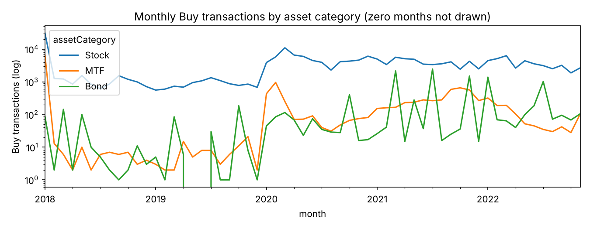
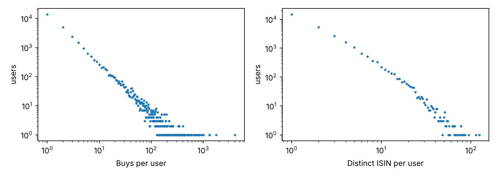

<!-- auto-generated by scripts/eda.py; do not edit by hand -->
# FAR-Trans exploratory analysis (Session 1)

Buy transactions: **228913** of 388048 rows; data end date 2022-11-30. Counts below are over Buy rows unless stated otherwise.

## 1. Volume over time

| Year | Stock | MTF | Bond | Total |
|---|---:|---:|---:|---:|
| 2018 | 42519 | 6600 | 370 | 49489 |
| 2019 | 10215 | 86 | 323 | 10624 |
| 2020 | 63192 | 2217 | 936 | 66345 |
| 2021 | 47729 | 3848 | 6617 | 58194 |
| 2022 | 39909 | 1139 | 3213 | 44261 |

Monthly counts: `tables/monthly_buys_by_category.csv`. January 2018 has 37474 Buys (the largest month; the median month has 3127); 35686 of them are dated 2018-01-02, the first day with transactions.

## 2. Activity per user

Users with at least one Buy: **29090**.

| | p50 | p75 | p90 | p99 | max |
|---|---:|---:|---:|---:|---:|
| Buys per user | 2 | 4 | 13 | 114 | 4047 |
| Distinct ISIN per user | 1 | 3 | 6 | 24 | 124 |

- Buys per user: 1: 13906 (47.80%); 2–4: 8833 (30.36%); 5–9: 2738 (9.41%); 10+: 3613 (12.42%).
- Distinct ISIN per user: 1: 14915 (51.27%); 2–4: 9560 (32.86%); 5–9: 2927 (10.06%); 10+: 1688 (5.80%).

## 3. Repeat purchases

A Buy is a *repeat* if the same user bought the same ISIN on an earlier row (same-day rows ordered by transactionID).

| Category | Buys | Repeat share | Distinct (user, ISIN) pairs |
|---|---:|---:|---:|
| Stock | 203564 | 67.10% | 66963 |
| MTF | 13890 | 11.32% | 12318 |
| Bond | 11459 | 7.47% | 10603 |
| All | 228913 | 60.73% | 89884 |

## 4. Popularity concentration

Distinct ISIN bought at least once: **320** (of 806 in asset_information).

| Category | Distinct ISIN bought | Top-10 share | Top-50 share |
|---|---:|---:|---:|
| Stock | 211 | 54.23% | 87.91% |
| MTF | 60 | 84.98% | 99.93% |
| Bond | 49 | 89.11% | 100.00% |
| All | 320 | 48.23% | 82.77% |

## 5. Provisional cut scenarios

> ⚠️ **NOT THE OFFICIAL SPLIT.** The official cut, item scope and evaluated users are pending. These cuts are exploratory, only to size a feasible evaluation.

Definitions: history = Buys with date `< T`; test window = `[T, data end]`; *evaluated user* = ≥1 Buy before `T` and ≥1 Buy in the test window; *target set* = distinct ISINs a user buys in the test window (the relevant items for nDCG@10); *target pairs* = (user, ISIN) pairs over all evaluated users; all scope = all asset categories.

| Measure | 2022-03-01 | 2022-06-01 | 2022-09-01 |
|---|---:|---:|---:|
| Eval users | 4211 | 3178 | 1728 |
| Target pairs | 12941 | 8475 | 4357 |
| Mean targets/user | 3.07 | 2.67 | 2.52 |
| Pairs already bought by user before T | 62.75% | 64.34% | 71.91% |
| Pairs in pre-T top-10 popular | 43.90% | 41.44% | 41.13% |
| Users with ≥1 target in pre-T top-10 | 63.90% | 58.09% | 59.49% |
| Target ISINs never bought before T (pairs) | 1142 (8.82%) | 1143 (13.49%) | 381 (8.74%) |
| Users with only new-to-user targets | 1346 (31.96%) | 1075 (33.83%) | 418 (24.19%) |
| Users with no snapshot available before T | 400 (9.50%) | 247 (7.77%) | 54 (3.12%) |
| Pairs via shared transactionID | 2278 (17.60%) | 1527 (18.02%) | 729 (16.73%) |
| Eval users by pre-T Buys: 1 / 2–4 / 5+ | 420 / 880 / 2911 | 289 / 566 / 2323 | 78 / 149 / 1501 |
| Users with Buys only in test window | 732 | 522 | 151 |
| Assets with a price before T | 792 | 796 | 803 |

## 6. Observations (facts from the tables above; no modelling claims)

- Stocks account for 88.93% of Buys; MTF 6.07%; Bond 5.01% (§1).
- 47.80% of users have exactly one Buy; the top 1% of users have at least 114 Buys (§2).
- 60.73% of all Buys repeat an ISIN the user already bought; for Stock 67.10%, for MTF 11.32%, for Bond 7.47% (§3).
- The 10 most bought ISINs cover 48.23% of Buys (§4).
- At the provisional cut 2022-03-01: 4211 evaluated users; 62.75% of target pairs were already bought by the same user before T, and 43.90% are in the pre-T top-10 (§5).
- Whether repeat purchases count as relevant items is not yet fixed by the protocol; the share above shows that this choice changes the task substantially.
