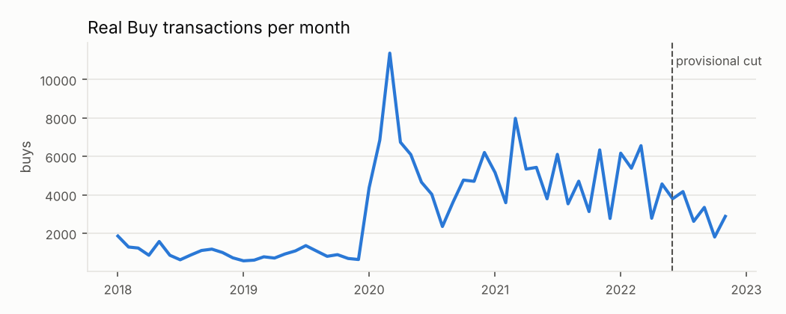
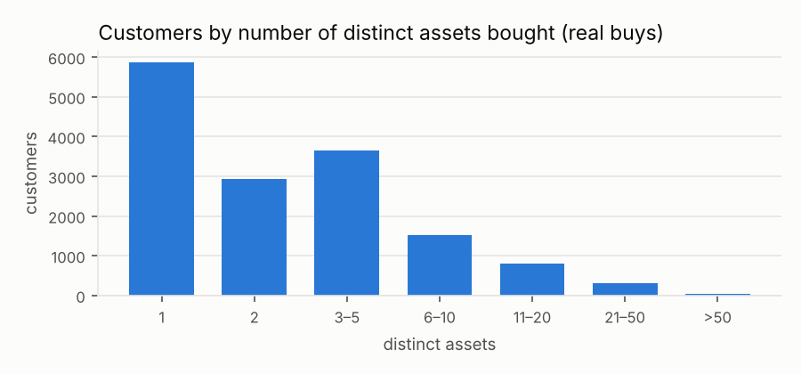
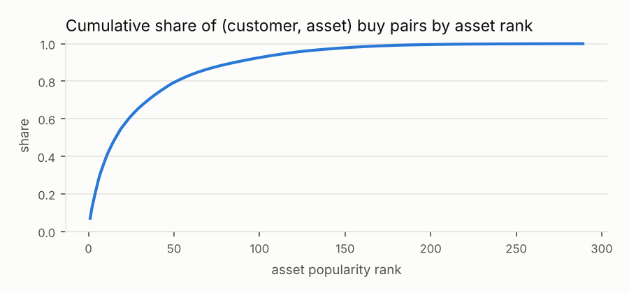

<!-- auto-generated by scripts/eda.py; do not edit by hand -->

# FAR-Trans EDA (for choosing the research question)

Provisional split (assumption, not official): train < 2022-05-31 ≤ test ≤ 2022-11-30 (FAR-Trans paper protocol, Δt = 6 months, latest cut).

## 1. Volume

| quantity | value |
|---|---|
| all transactions | 388,048 |
| Buy / Sell | 228,913 / 159,135 |
| reconstructed buys (transactionID < 0) | 38,019 |
| real buys | 190,894 |
| unique (customer, asset) buy pairs, real | 59,844 |
| customers / traded assets | 29,090 / 320 |
| density of real buy pairs | 1.3703% |

## 2. Customer activity (real buys)

Customers with ≥1 real buy: 15,112. Distinct assets per customer: median 2, mean 4.0, p90 9, max 124. Exactly one asset: 38.8%; ≤ 2 assets: 58.2%.

Repeat buys: 68.7% of real buys are of an asset the customer had already bought (incl. reconstructed holdings: 72.7%).

## 3. Item popularity

Assets with ≥1 real buy: 289. Top-10 assets cover 38.7% of buy pairs, top-20 55.9%, top-50 79.4%.

Buy pairs by asset category (real buys):

| category | pairs | share |
|---|---|---|
| Stock | 43635 | 72.9% |
| Bond | 10130 | 16.9% |
| MTF | 6079 | 10.2% |

Top-10 assets by buyers:

| ISIN | buyers | assetName | assetCategory |
|---|---|---|---|
| GRS003003035 | 4188 | NATIONAL BANK OF GREECE | Stock |
| GRS015003007 | 3240 | ALPHA SERVICES AND HOLDINGS S.A. | Stock |
| GRC5091217D9 | 2461 | PRODEA R.E.I.C. S.A. | Bond |
| GRS014003032 | 2454 | PIRAEUS FINANCIAL HOLDINGS S.A. | Stock |
| GRS323003012 | 2237 | EUROBANK ERGASIAS SERVICES AND HOLDINGS S.A. | Stock |
| GRC4261213D5 | 2190 | MOTOR OIL HELLAS CORINTH REFINERIES SA | Bond |
| GRS434003000 | 1844 | PPC SA | Stock |
| GRS393503008 | 1538 | MYTILINAIOS SA | Stock |
| GRS419003009 | 1529 | OPAP SA | Stock |
| GRC281121BD8 | 1491 | ELVALHALCOR HELLENIC COPPER AND ALUMINIUM INDUSTRY S.A. | Bond |

## 4. Customer profile fields

| customerType | customers |
|---|---|
| Mass | 18610 |
| Premium | 8906 |
| Professional | 1327 |
| Inactive | 208 |
| Legal Entity | 39 |

| latest snapshot | riskLevel | investmentCapacity |
|---|---|---|
| predicted | 24.5% | 25.2% |
| missing | 1.1% | 1.1% |

## 5. Provisional split diagnostics

| quantity | value |
|---|---|
| eligible universe (priced for whole test window) | 511 assets |
| test buyers (≥1 real buy in test) | 3,668 |
| …with ≥1 buy before the cut (warm) | 3,145 |
| …cold-start (no buy before the cut) | 523 (14.3%) |
| evaluated users, variant A (new pairs only) | 1,132 |
| evaluated users, variant B (all buys) | 2,590 |
| mean relevant assets / user, A | 1.67 |
| mean relevant assets / user, B | 2.84 |
| share of B-relevant pairs that are repeats | 74.3% |
| assets bought in test never bought before the cut | 12 |

Reference baselines on the provisional split (nDCG@10, mean over users; columns split users by number of distinct assets bought before the cut):

| method | users | nDCG@10 | hist = 1 | hist 2–4 | hist ≥ 5 |
|---|---|---|---|---|---|
| Popularity, last 6 m (A, exclude owned) | 1132 | 0.1929 | 0.2191 | 0.2110 | 0.1814 |
| Popularity, all train (A, exclude owned) | 1132 | 0.1918 | 0.2118 | 0.2327 | 0.1740 |
| Popularity, last 6 m (B) | 2590 | 0.2858 | 0.2567 | 0.2956 | 0.2871 |
| Repeat own (recency) + popularity (B) | 2590 | 0.5938 | 0.5843 | 0.6472 | 0.5759 |

Variant-A user groups: hist = 1: 152; 2–4: 245; ≥ 5: 735.

For scale: the FAR-Trans paper reports nDCG@10 = 0.2710 for Popularity and 0.3404 for LightGCN, averaged over 61 bi-weekly cut points (2019-08 … ), so numbers here are a single-cut sanity check only.

## 6. Profile availability for evaluated users (variant A) at the cut

Point-in-time profile exists for 98.8% of evaluated users; among them riskLevel is predicted for 5.1% and missing for 0.3%; investmentCapacity predicted for 5.1%.

Relevant (variant A) pairs by asset category: Stock: 1,679 (88.9%), Bond: 172 (9.1%), MTF: 37 (2.0%)

